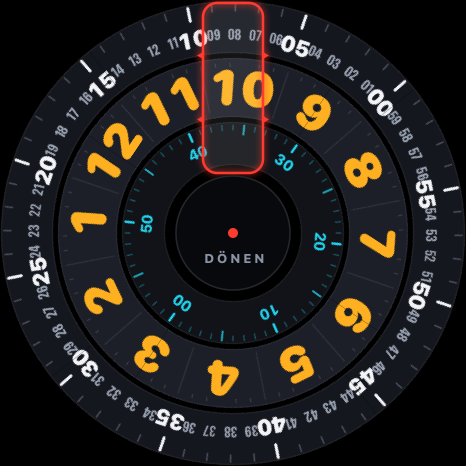
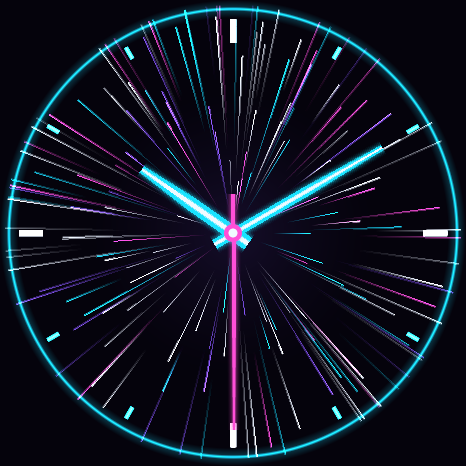

<p align="center"></p>

<h1 align="center">HuaSideload</h1>

<p align="center"><b>Install custom watch faces, your own apps and music on Huawei watches from an iPhone.</b><br>No Android phone needed.</p>

<p align="center">▶ <a href="https://youtu.be/za6RO3lPc5c">The story behind this project</a> (YouTube, 10 min, in Turkish and English)</p>

Huawei Health on iPhone can pair with a Huawei watch, but it cannot install custom watch faces, third-party watch
apps or music; Huawei only allows that from Android phones. **HuaSideload** is an iOS app that talks
to Huawei *lite wearable* watches directly over Bluetooth LE: it pairs with the watch, **installs custom
watch faces** (any `.hwt`), **installs your own watch apps** (signed HarmonyOS/OpenHarmony lite JS apps, built with
the included tools), **uploads music** to the watch's player, gives your watch apps a JSON message channel to the iPhone, and
**plays the iPhone's audio on the watch speaker** (with a call trick). Three ready-made games (Dino, Flappy, Snake)
and two watch faces are included.

> **Huawei Health:** two ways, pick one:
> - **With Huawei Health:** set the watch up once with Huawei Health as usual. After that HuaSideload pairs with the
>   watch on its own; leave **Send setup after pairing** off.
> - **Without Huawei Health:** a new or factory-reset watch can be set up by HuaSideload alone: turn on **Send setup
>   after pairing** (Watch tab), leave the account ID empty and pair. Tested on a GT 3 SE. The watch then belongs to
>   no Huawei account; pairing it with Huawei Health later resets it.
>
> Don't mix the two: on a watch set up with Huawei Health, the setup with an empty or wrong account ID can make the
> watch reset itself. Not a big loss usually, you just set it up with Huawei Health again, but double-check the ID first.

The Huawei protocol is a Swift port of [Gadgetbridge](https://codeberg.org/Freeyourgadget/Gadgetbridge)'s
implementation. The app UI is available in **English and Turkish** (globe menu, top right).

> 🛠 **Building your own watch apps or features?** Everything for developers is in the
> **[developer guide](docs/DEVELOPMENT.md)**: signing, the sample app, the games, messaging with the phone,
> watch app pitfalls and how the protocol works.

---

## Contents
1. [What it does and doesn't do](#1-what-it-does-and-doesnt-do)
2. [Requirements](#2-requirements)
3. [Install the iPhone app and pair the watch](#3-install-the-iphone-app-and-pair-the-watch)
4. [Watch apps and watch faces](#4-watch-apps-and-watch-faces)
5. [Troubleshooting](#5-troubleshooting)
6. [Credits and license](#6-credits-and-license)

**For developers:** [developer guide](docs/DEVELOPMENT.md) (own watch apps, signing, games, messaging, protocol)

---

## 1. What it does and doesn't do

**Does:**
- Pairs with the watch over BLE (HiChain), encrypted connection, automatic reconnect; stays connected in the
  background, even when iOS closes the app (it relaunches the app for the watch)
- Battery and watch info, notifications to the watch
- **Installs custom watch faces** (any `.hwt`, e.g. from Huawei Theme Studio); no debug profile needed, two
  ready-made faces are bundled (section 4.6)
- **Installs and removes your own watch apps** (signed `.bin` with a debug profile)
- Comes with three games to build for your watch: **Dino, Flappy, Snake** ([developer guide](docs/DEVELOPMENT.md#25-ready-made-games-dino-flappy-snake))
- Uploads **MP3/M4A/AAC/FLAC/WAV/OPUS** to the watch's own music player (to listen without the phone)
- **JSON messaging** between your watch apps and the phone (Wear Engine P2P)
- Shows the watch's **UDID** (needed for the debug profile; no Android phone required)
- **Plays the iPhone's audio on the watch speaker**: Spotify, Apple Music, YouTube, podcasts… (section 3.1)

**Doesn't (at least for now, tried; limited by the watch hardware or iOS):**
- Music quality on the watch speaker: the watch is no Bluetooth music receiver (A2DP), so the audio goes over the
  call channel at phone-call quality (section 3.1)
- Skip songs of another app from the watch: iOS doesn't let one app control another app's player (a feature with
  that player's own API can, see 3.1)
- Upload DRM-protected songs (Spotify, Apple Music) to the watch
- Give watch apps internet access (but the phone app can send them any data)

**Tested watches:**

| Watch | Firmware | What works | Note | Source |
|---|---|---|---|---|
| HUAWEI WATCH GT 3 SE | 3.0.0.69 | Everything in this README | 466×466 round, OpenHarmony 1.1 lite wearable, API 6 | Tested by me |
| HUAWEI WATCH GT 3 | – | Custom watch face | iOS 26.6.1 | [#5](https://github.com/burak4arslan/huawei-watch-sideload-ios/issues/5) |
| HUAWEI WATCH GT 4 | 5.0.0.88 | Custom watch face | Needs the account setup (4.6) | [#6](https://github.com/burak4arslan/huawei-watch-sideload-ios/issues/6) |
| HUAWEI Band 11 | 6.0.0.130 | Custom watch face (two bands) | Needs the account setup (4.6) | [#4](https://github.com/burak4arslan/huawei-watch-sideload-ios/issues/4) |
| HUAWEI WATCH GT 2 Pro | – | Pairing, watch info, P2P messages to a watch app | Uses HiChain Lite pairing (experimental), added by [huydung1232007](https://github.com/huydung1232007/huawei-watch-sideload-ios) | Fork owner's tester |

Other Huawei *lite wearable* watches on the same platform (GT 2, …) will likely work but are untested.
HarmonyOS *wearable* watches (Watch 3/4) are a different platform.

> ⚠️ **Disclaimer:** This uses an unofficial protocol. Pairing with HuaSideload may break the Huawei Health
> connection; if something goes wrong you may need to reset the watch and pair it with Health again.
> This project is not affiliated with Huawei. Use at your own risk.

---

## 2. Requirements

- An iPhone and an Apple ID (a free one works; the app then has to be reinstalled every 7 days).
- **No Mac needed** with the prebuilt app (section 3). To build it yourself: a Mac with **Xcode 16+** and
  **XcodeGen** (`brew install xcodegen`).
- Pairing, watch faces, music and notifications need nothing else. Your own watch apps also need a Huawei developer
  account and the OpenHarmony SDK: see the [developer guide](docs/DEVELOPMENT.md#1-requirements).

---

## 3. Install the iPhone app and pair the watch

**Without a Mac (prebuilt app):** download `HuaSideload-x.y.ipa` from
[Releases](https://github.com/burak4arslan/huawei-watch-sideload-ios/releases/latest) and install it with
[Sideloadly](https://sideloadly.io) or [AltStore](https://altstore.io) using your own Apple ID. Then on the iPhone:
Settings → General → VPN & Device Management → trust your Apple ID, and turn on Developer Mode if iOS asks. With a
free Apple ID the app has to be reinstalled every 7 days. If your own watch apps will message the phone ([developer guide](docs/DEVELOPMENT.md#24-talking-to-the-phone)), build
the app yourself instead: the sideloading tool may change the bundle ID.
To build an unsigned IPA with your own bundle ID without a Mac, fork the repository and run
*Actions → Build unsigned IPA*.

**Building it yourself (Mac + Xcode):**

```bash
git clone https://github.com/burak4arslan/huawei-watch-sideload-ios.git HuaSideload && cd HuaSideload
cp Config/local.env.example Config/local.env   # fill in your Team ID and bundle ID
./generate.sh                                  # creates HuaSideload.xcodeproj
open HuaSideload.xcodeproj                     # pick your iPhone, Run
```

- **Team ID:** Xcode → Settings → Accounts → your account → Team. You can also leave it empty and pick the team in Xcode under *Signing & Capabilities*.
- **Bundle ID:** something unique, e.g. `com.yourname.huasideload`. Your watch apps send their messages to this ID.

**The app** has four tabs: **Watch** (status, pairing, a notification to the watch), **Install** (watch apps,
watch faces, music for the watch's player), **Features** (the watch speaker and your own features) and **Log**.

**Pairing** (the watch must have been set up once with Huawei Health):
1. Close Huawei Health (swipe it up in the app switcher).
2. **Watch** tab → **Find watch** → tap your watch. If it is connected to Huawei Health it shows up as "connected to phone".
3. **Pair**. If the watch asks for confirmation, accept it.
4. From then on HuaSideload reconnects and pairs automatically.

**UDID:** after pairing it appears on the **Watch** tab under Status, hidden. **Show identity** reveals it, **Copy UDID** copies it. You need it for the debug profile ([developer guide](docs/DEVELOPMENT.md#21-huawei-developer-account-and-signing-once)).

**Language:** the globe menu (top right) switches between English and Turkish. The first launch follows the phone's language.

**In the background:** leave HuaSideload in the background, don't swipe it away in the app switcher. If iOS closes it
to free memory, iOS keeps the connection to the watch and opens the app again in the background when the watch needs
it. After you swipe it away, open it once (after restarting the iPhone too, to be safe).

### 3.1 Listening on the watch speaker

The watch is no Bluetooth music receiver, but it has a speaker for calls, and it opens that speaker for an answered
incoming call. HuaSideload rings the watch with such a call:

1. **Features → Watch speaker → Play the phone's audio on the watch.** The watch rings like a call ("HuaSideload").
2. Answer it on the watch.
3. Play something in any app on the iPhone: Spotify, Apple Music, YouTube, a podcast. It comes out of the watch speaker.
4. Hang up on the watch (or **End** in the app) to stop.

Good to know:
- The watch has to be connected to the iPhone for calls. If phone or Teams calls ring on the watch, it is; if not, the
  app says so (connect it in the iPhone's Bluetooth settings).
- **Phone-call quality** (mono, voice bandwidth). If it crackles, turn the volume down a bit or pick an equalizer
  preset that cuts bass (the speaker is tiny).
- While it plays, the watch shows its call screen. It can't be left, and its buttons don't reach the phone: change
  songs on the phone. The **volume** panel on the watch changes the iPhone's volume.
- Nothing is recorded or captured: the app only plays silence to keep the call's audio route open, and the other
  app's audio takes that route by itself.
- Only an answered *incoming* call works. An outgoing call, or routing audio to the watch without a call, plays
  nothing on the watch (tested).
- **For features:** the speaker events and volume gestures are in the
  [developer guide](docs/DEVELOPMENT.md#26-the-watch-speaker-in-your-features).

---

## 4. Watch apps and watch faces

**4.1–4.5 Your own watch apps** are in the [developer guide](docs/DEVELOPMENT.md#2-your-own-watch-app):
[signing](docs/DEVELOPMENT.md#21-huawei-developer-account-and-signing-once) ·
[sample app](docs/DEVELOPMENT.md#22-start-from-the-sample) ·
[build and install](docs/DEVELOPMENT.md#23-build-bundle-into-the-iphone-app-install-on-the-watch) ·
[talking to the phone](docs/DEVELOPMENT.md#24-talking-to-the-phone) ·
[games: Dino, Flappy, Snake](docs/DEVELOPMENT.md#25-ready-made-games-dino-flappy-snake)

### 4.6 Watch faces

Watch faces don't need a debug profile. Every `.hwt` in `WatchFaces/` is bundled into the iPhone app and shows up
on the **Install** tab under **Watch faces** with an install button; **Install a watch face (.hwt)** uploads any other `.hwt` file.
After the upload, touch and hold the watch face on the watch and pick the new one.

**Newer watches and bands (e.g. Band 11, GT 4) reject the upload with error 100004** until the phone tells them the Huawei
account they belong to: turn on **Send setup after pairing** on the **Watch** tab, enter the Huawei account ID the
watch was set up with, then **Forget pairing** → **Pair** and install again
([#4](https://github.com/burak4arslan/huawei-watch-sideload-ios/issues/4),
[#6](https://github.com/burak4arslan/huawei-watch-sideload-ios/issues/6)). Double-check the ID first: with a wrong
one the watch says the accounts don't match and may reset itself, so you'd have to set it up with Huawei Health again.
The face stays on the watch after you switch back to Huawei Health.

| | | |
|---|---|---|
|  | **Donen** ("spinning" in Turkish) | no hands: the hour, minute and second rings turn under a fixed red window |
|  | **Light Speed** | analog hands over streaks of light |

Both are made for 466×466 round screens (tested on a GT 3 SE).

---

## 5. Troubleshooting

- **The watch is not in the list:** if it's actively connected to another phone or to Huawei Health it may not show up. Close Health, toggle Bluetooth, **Find watch**.
- **Pairing times out at "1/4 Link parameters" and the log is full of "could not decrypt" packets:** Huawei Health is connected to the watch on the same iPhone and syncing; those packets are its traffic, and the watch ignores HuaSideload until Health lets go. Close Health, turn it off in iOS **Settings → Privacy & Security → Bluetooth** for now, restart the watch, then **Forget pairing** → **Pair**. When you're done, **Disconnect (release for Huawei Health)** and turn Health's Bluetooth permission back on. No watch reset needed ([#6](https://github.com/burak4arslan/huawei-watch-sideload-ios/issues/6)).
- **"Verification failed: the saved key is no longer valid":** the watch was reset. **Forget pairing** → **Pair** again.
- **Newer watches (Watch Fit 4 Pro, GT 6, GT 7…): "Pairing failed" right after pairing:** these watches wait for setup messages after pairing. Turn on **Send setup after pairing (newer watches)** on the **Watch** tab and pair again; if the watch was set up with Huawei Health, enter that Huawei account ID first. ⚠️ Double-check the ID: with an empty or wrong account ID the watch says "phone and watch accounts don't match" and may reset itself. Then set it up with Huawei Health again and pair once more with the right ID.
- **Pairing stops at "HiChain JSON could not be decoded" or you want to report a pairing problem:** turn on pairing diagnostics (**Log** tab) and attach the log. It shows packet layouts only, no keys, PIN, UDID or MAC.
- **Watch face install fails with 100004:** the watch wants its Huawei account ID first, see section 4.6.
- **The watch face transfers but never shows up on the watch:** try another **Upload method** under Watch faces. Full HarmonyOS watches may want the whole package instead of watchface.bin. The app checks the watch's face list for up to 90 s and logs what it found.
- **The watch loses the phone after a while:** check that HuaSideload wasn't swiped away (section 3, "In the background"). The log shows "iOS relaunched the app in the background for the watch" when iOS brought it back.
- **Watch speaker: "not connected to the iPhone for calls":** in the iPhone's Bluetooth settings, tap the watch to connect it; calls must ring on the watch.
- **Questions and bug reports:** [GitHub Issues](https://github.com/burak4arslan/huawei-watch-sideload-ios/issues). Attach the log.
- **Sharing the log:** **Copy** on the **Log** tab. Identity details stay masked unless **Show identity** is on.
- **Your own watch apps** (install fails with 103, "Could not reach the phone", live log on a Mac): see the
  [developer guide's troubleshooting](docs/DEVELOPMENT.md#5-troubleshooting-for-developers).

---

## 6. Credits and license

- The Huawei protocol was ported to Swift from the Huawei support in [Gadgetbridge](https://codeberg.org/Freeyourgadget/Gadgetbridge) (AGPL-3.0); therefore this project is licensed under **AGPL-3.0** as well (`LICENSE`).
- The watch-side install rules were found by reading OpenHarmony's `appexecfwk_lite` and `security_appverify` sources (Apache-2.0).
- The games are fan-made tributes and are not affiliated with the original games or their owners: Dino follows Chrome's offline dinosaur game, Flappy is inspired by Flappy Bird, Snake by the classic Nokia game. All their images are drawn by the scripts in this repository.
- `bridge.js` follows the logic of Huawei's Wear Engine lite wearable JS SDK (Apache-2.0), trimmed down.
- [The-jawi](https://github.com/The-jawi) contributed the tolerant HiChain reply parsing, the setup messages after pairing, Keychain storage for pairing keys, watch face confirmation (service 0x27), the unit tests and the IPA build workflow, while getting a Watch Fit 4 Pro to pair.

HUAWEI, HarmonyOS and AppGallery are trademarks of Huawei Technologies Co., Ltd. This project is not affiliated with Huawei.
