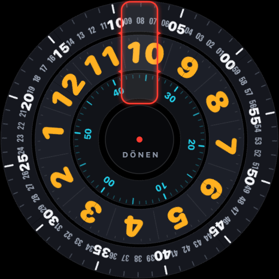
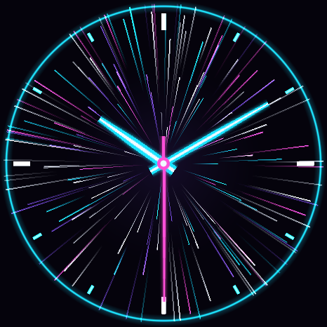

<p align="center"></p>

<h1 align="center">HuaSideload</h1>

<p align="center"><b>Sideload your own apps and music onto Huawei watches from an iPhone.</b><br>No Android phone needed.</p>

Huawei Health on iPhone can pair with a Huawei watch, but it cannot install third-party watch apps or copy
music to the watch; Huawei only allows that from Android phones. **HuaSideload** is an iOS app that talks
to Huawei *lite wearable* watches directly over Bluetooth LE: it pairs with the watch, **installs your own
watch apps** (signed HarmonyOS/OpenHarmony lite JS apps, built with the included tools), **installs watch
faces**, **uploads music** to the watch's player, gives your watch apps a JSON message channel to the iPhone, and
**plays the iPhone's audio on the watch speaker** (with a call trick). Three ready-made games (Dino, Flappy, Snake)
and two watch faces are included.

> **Huawei Health:** set the watch up once with Huawei Health as usual (language, region, terms). After that
> HuaSideload pairs with the watch on its own and does not need Huawei Health. Setting up a brand-new or
> factory-reset watch with HuaSideload alone has not been tested.

The Huawei protocol is a Swift port of [Gadgetbridge](https://codeberg.org/Freeyourgadget/Gadgetbridge)'s
implementation. The app UI is available in **English and Turkish** (globe menu, top right).

---

## Contents
1. [What it does and doesn't do](#1-what-it-does-and-doesnt-do)
2. [Requirements](#2-requirements)
3. [Install the iPhone app and pair the watch](#3-install-the-iphone-app-and-pair-the-watch)
4. [Your own watch app](#4-your-own-watch-app)
5. [Things to know when writing watch apps](#5-things-to-know-when-writing-watch-apps)
6. [Keeping your own features in a separate project](#6-keeping-your-own-features-in-a-separate-project)
7. [Troubleshooting](#7-troubleshooting)
8. [Project layout and how it works](#8-project-layout-and-how-it-works)
9. [Credits and license](#9-credits-and-license)

---

## 1. What it does and doesn't do

**Does:**
- Pairs with the watch over BLE (HiChain), encrypted connection, automatic reconnect; stays connected in the
  background, even when iOS closes the app (it relaunches the app for the watch)
- Battery and watch info, notifications to the watch
- **Installs and removes your own watch apps** (signed `.bin` with a debug profile)
- **Installs watch faces** (`.hwt` from Huawei Theme Studio); two ready-made faces are bundled
- Comes with three games to build for your watch: **Dino, Flappy, Snake** (section 4.5)
- Uploads **MP3/M4A/AAC/FLAC/WAV/OPUS** to the watch's own music player (to listen without the phone)
- **JSON messaging** between your watch apps and the phone (Wear Engine P2P)
- Shows the watch's **UDID** (needed for the debug profile; no Android phone required)
- **Plays the iPhone's audio on the watch speaker**: Spotify, Apple Music, YouTube, podcasts… (section 3.1)

**Doesn't (at least for now, tried; limited by the watch hardware or iOS):**
- Music quality on the watch speaker: the watch is no Bluetooth music receiver (A2DP), so the audio goes over the
  call channel at phone-call quality (section 3.1)
- Skip songs of another app from the watch: iOS doesn't let one app control another app's player (a feature with
  that player's own API can, see 3.1)
- Upload DRM-protected songs (Spotify, Apple Music) to the watch
- Give watch apps internet access (but the phone app can send them any data)

**Tested watch:** HUAWEI WATCH GT 3 SE (firmware 3.0.0.69, OpenHarmony 1.1 based lite wearable, API 6,
466×466 round screen). Other Huawei *lite wearable* watches on the same platform (GT 2 Pro, GT 3, …) will
likely work but are untested. HarmonyOS *wearable* watches (Watch 3/4) are a different platform.

> ⚠️ **Disclaimer:** This uses an unofficial protocol. Pairing with HuaSideload may break the Huawei Health
> connection; if something goes wrong you may need to reset the watch and pair it with Health again.
> This project is not affiliated with Huawei. Use at your own risk.

---

## 2. Requirements

| | What for | How |
|---|---|---|
| Mac + **Xcode 16+** | the iPhone app | App Store |
| **XcodeGen** | generating the Xcode project | `brew install xcodegen` |
| Apple ID | installing on your iPhone | A free account works (apps must be reinstalled every 7 days) |
| **Huawei developer account** | signing watch apps | Free, [developer.huawei.com](https://developer.huawei.com) |
| **OpenHarmony SDK (API 9)** | compiling watch apps | DevEco Studio 3.1 → Settings → SDK → OpenHarmony API 9 (`js` and `toolchains`). Default location: `~/Library/Huawei/Sdk/openharmony/9` |
| **Node.js 16** | the watch app compiler (ace-loader) | the Node that DevEco installs, or `nvm install 16`. Newer versions don't work |
| **Java 11+** | packing and signing tools | `brew install openjdk@17` |
| Python 3 | helper tools | comes with macOS |

If the SDK or Node live elsewhere, set `OHOS_SDK=/path` or `NODE16=/path/to/node`.

> If you only want the iPhone app (pairing, music upload, notifications) you don't need the Huawei account
> or the OpenHarmony SDK; those are only for installing your own watch apps.

---

## 3. Install the iPhone app and pair the watch

```bash
git clone https://github.com/Burak4Arslan/huawei-watch-sideload-ios.git HuaSideload && cd HuaSideload
cp Config/local.env.example Config/local.env   # fill in your Team ID and bundle ID
./generate.sh                                  # creates HuaSideload.xcodeproj
open HuaSideload.xcodeproj                     # pick your iPhone, Run
```

- **Team ID:** Xcode → Settings → Accounts → your account → Team. You can also leave it empty and pick the team in Xcode under *Signing & Capabilities*.
- **Bundle ID:** something unique, e.g. `com.yourname.huasideload`. Your watch apps send their messages to this ID.

**The app** has four tabs: **Watch** (status, pairing, a notification to the watch), **Install** (watch apps,
watch faces, music for the watch's player), **Features** (the watch speaker and your own features) and **Log**.

**Pairing** (the watch must have been set up once with Huawei Health):
1. Close Huawei Health (swipe it up in the app switcher).
2. **Watch** tab → **Find watch** → tap your watch. If it is connected to Huawei Health it shows up as "connected to phone".
3. **Pair**. If the watch asks for confirmation, accept it.
4. From then on HuaSideload reconnects and pairs automatically.

**UDID:** after pairing it appears on the **Watch** tab under Status, hidden. **Show identity** reveals it, **Copy UDID** copies it. You need it for the debug profile.

**Language:** the globe menu (top right) switches between English and Turkish. The first launch follows the phone's language.

**In the background:** leave HuaSideload in the background, don't swipe it away in the app switcher. If iOS closes it
to free memory, iOS keeps the connection to the watch and opens the app again in the background when the watch needs
it. After you swipe it away, open it once (after restarting the iPhone too, to be safe).

### 3.1 Listening on the watch speaker

The watch is no Bluetooth music receiver, but it has a speaker for calls, and it opens that speaker for an answered
incoming call. HuaSideload rings the watch with such a call:

1. **Features → Watch speaker → Play the phone's audio on the watch.** The watch rings like a call ("HuaSideload").
2. Answer it on the watch.
3. Play something in any app on the iPhone: Spotify, Apple Music, YouTube, a podcast. It comes out of the watch speaker.
4. Hang up on the watch (or **End** in the app) to stop.

Good to know:
- The watch has to be connected to the iPhone for calls. If phone or Teams calls ring on the watch, it is; if not, the
  app says so (connect it in the iPhone's Bluetooth settings).
- **Phone-call quality** (mono, voice bandwidth). If it crackles, turn the volume down a bit or pick an equalizer
  preset that cuts bass (the speaker is tiny).
- While it plays, the watch shows its call screen. It can't be left, and its buttons don't reach the phone: change
  songs on the phone. The **volume** panel on the watch changes the iPhone's volume.
- Nothing is recorded or captured: the app only plays silence to keep the call's audio route open, and the other
  app's audio takes that route by itself.
- Only an answered *incoming* call works. An outgoing call, or routing audio to the watch without a call, plays
  nothing on the watch (tested).
- **For features:** `host.speaker` (`WatchSpeaker`) tells when the speaker is on and off (`onPlaying`, `onEnded`), can
  ring the watch (`ring()`), and reports gestures with the watch's volume panel (`onVolumeGesture`): down a little and
  right back up, that twice, or down to the bottom and up again. The watch never changes the volume on its own, so a
  feature can use them to control its own player, e.g. through the Spotify Web API. (The mic button can't be used
  reliably: in quiet parts of a song the watch mutes its mic on its own too.)

---

## 4. Your own watch app

### 4.1 Huawei developer account and signing (once)

The watch only installs apps signed with a Huawei-issued debug profile that **contains your watch's UDID**.

**a) Create a key and a CSR** (with the signing tool from the OpenHarmony SDK):
```bash
SDK=~/Library/Huawei/Sdk/openharmony/9
mkdir -p signing && cd signing
java -jar $SDK/toolchains/lib/hap-sign-tool.jar generate-keypair \
  -keyAlias mykey -keyAlg ECC -keySize NIST-P-256 \
  -keystoreFile mykey.p12 -keyPwd YOURPASSWORD -keystorePwd YOURPASSWORD
java -jar $SDK/toolchains/lib/hap-sign-tool.jar generate-csr \
  -keyAlias mykey -keyPwd YOURPASSWORD -keystoreFile mykey.p12 -keystorePwd YOURPASSWORD \
  -subject "C=US,O=Your Name,OU=Your Name,CN=mykey" -signAlg SHA256withECDSA -outFile mykey.csr
echo -n YOURPASSWORD > password.txt
```

**b) In AppGallery Connect** ([developer.huawei.com](https://developer.huawei.com) → AppGallery Connect):
1. **Certificates, App ID and Profiles → Certificates → New:** type **Debug**, upload `mykey.csr`, download the `.cer` → `signing/mykey-debug.cer`.
2. **Devices → Add:** type **Sports watch** (lite wearable), paste the UDID from HuaSideload.
3. **My projects → create a project → Add app:** HarmonyOS app, device **Sports watch**, package name (e.g. `com.yourname.huasideload.sample`). Don't select any capabilities or permissions.
4. **Profiles → Add:** that app, type **Debug**, your certificate, your watch → download the `.p7b` → save it named after the app's package, e.g. `signing/profiles/com.yourname.huasideload.sample.p7b`.

Repeat steps 3 and 4 for every new watch app. The key, certificate and device stay the same.

**c) `signing/signing.env`:** copy `signing/signing.env.example` and fill in the file names. Nothing in `signing/` is committed to git.

### 4.2 Start from the sample

```bash
cp -R watch-apps/sample watch-apps/my-app
```
- `entry/src/main/config.json` → set `bundleName` to your package name from AppGallery Connect.
- `resources/base/element/string.json` → `app_name` (the name shown on the watch, at most 30 characters).
- Icon: `python3 tools/make-app-icon.py watch-apps/my-app 2A6FDB` (a colored disc), or put your own `icon.png` (114×114) and `icon_small.png` (41×41) in `resources/base/media/`.

### 4.3 Build, bundle into the iPhone app, install on the watch

```bash
tools/build-watch-app.sh watch-apps/my-app     # → WatchApps/My App.bin  (file name = app_name)
./generate.sh                                  # adds the new .bin to the Xcode project
```
1. Run the iPhone app from Xcode again.
2. **Install** tab → **Watch apps** → **"Install … on the watch"**.
3. When it's done the app appears in the watch's app list. To remove it: **Show apps on the watch** → **Delete**.

At the end `build-watch-app.sh` checks the package against the watch installer's rules with
`tools/check-watch-bin.py`. If it says "WILL NOT INSTALL", the reason is printed right there.

**Updating:** **increase** `version.code` in `config.json` (the watch refuses the same or a lower version), build, install again.

### 4.4 Talking to the phone

On the watch, `common/bridge.js`:
```js
import bridge from '../../common/bridge.js';
bridge.listen(function (message) { /* from the phone: {"t": ..., ...} */ });
bridge.start();
bridge.send({ t: 'hello' }, function (ok) { /* delivered? */ });
```

On the iPhone, a `WatchFeature` (see `HuaSideload/HelloFeature.swift`):
```swift
final class MyFeature: WatchFeature {
    private weak var host: WatchFeatureHost?
    var watchPackages: [String] { ["com.yourname.huasideload.sample"] }
    func attach(to host: WatchFeatureHost) { self.host = host }
    func handle(_ message: [String: Any], from package: String) async -> Bool {
        guard message["t"] as? String == "hello" else { return false }
        host?.bridge(for: package)?.send(["t": "hello", "s": "Hi!"])
        return true
    }
}
```
Add it in `WatchFeatures.load()`, or keep it in a separate project as described in section 6.
A feature can also put its own sections on the **Features** tab (`sections()`).

### 4.5 Ready-made games: Dino, Flappy, Snake

`watch-apps/` has three games for 466×466 round screens, tested on a HUAWEI WATCH GT 3 SE. Signed builds can't be
shared (a `.bin` is signed for one developer's watches), so build them with your own signing like any other app:

| Game | Folder | What it is |
|---|---|---|
| **Dino** | `watch-apps/dino` | endless runner: tap to jump over cacti and birds, day and night mode |
| **Flappy** | `watch-apps/flappy` | tap to fly through the pipes; after a new best score it sends `{"t": "flappy", "s": score, "b": best}` to the iPhone (a `bridge.js` example: handle it in your own `WatchFeature`, section 4.4) |
| **Snake** | `watch-apps/snake` | Nokia-style snake on a round arena without walls; it turns toward your tap |

For each game:
1. AppGallery Connect: add an app with your own package name (e.g. `com.yourname.huasideload.dino`) and a debug profile for it (section 4.1, steps 3 and 4).
2. Put that package name into the game's `entry/src/main/config.json` → `bundleName`.
3. Build: `HUASIDELOAD_LEGACY_IMAGES=1 tools/build-watch-app.sh watch-apps/dino`, then `./generate.sh` and run the iPhone app again (section 4.3).

`HUASIDELOAD_LEGACY_IMAGES=1` keeps only one copy of every image in the package (the compiler writes each image
twice), which makes Dino about 40% smaller. The images are generated by `tools/make_sprites.py` / `tools/make_assets.py`
inside each game folder.

### 4.6 Watch faces

Watch faces don't need a debug profile. Every `.hwt` in `WatchFaces/` is bundled into the iPhone app and shows up
on the **Install** tab under **Watch faces** with an install button; **Install a watch face (.hwt)** uploads any other `.hwt` file.
After the upload, touch and hold the watch face on the watch and pick the new one.

| | | |
|---|---|---|
|  | **Donen** ("spinning" in Turkish) | no hands: the hour, minute and second rings turn under a fixed red window |
|  | **Light Speed** | analog hands over streaks of light |

Both are made for 466×466 round screens (tested on a GT 3 SE).

---

## 5. Things to know when writing watch apps

All of these were found by testing on the watch. Most of them give no error message at all: just "103",
a black screen or a frozen watch.

| Symptom | Cause | Fix |
|---|---|---|
| Install fails with **103** | no `icon_small.bin` in the icon folder | add `resources/base/media/icon_small.png` (41×41) |
| Install fails with **103** | your watch's UDID is not in the profile / wrong package name / wrong certificate | check 4.1; `tools/check-watch-bin.py` inspects the package |
| Install fails with **103** | `version.code` is not higher than the installed version | increase it |
| **Black screen** at launch | `import x from '@system.wearengine'` (not known to the OpenHarmony compiler; webpack emits code that throws at runtime) | load it with `requireModule('@system.wearengine')` inside try/catch (`bridge.js` does this). The build tool stops on `COMPILE RESULT:FAIL` |
| Watch **freezes** at launch | starting the phone connection on the very first page at launch | a plain splash page (`pages/index`) + `router.replace` to the real page, connect there |
| Watch **freezes** at launch | `config.json` → `module.metaData` → `supportLists` | leave it out; messaging works without it |
| Drawings pile up, memory fills | the lite `canvas` has no `clearRect` | recreate the canvas with `if` (swap between two canvases) |
| `fillText` draws nothing | the canvas font needs a font family name | draw text with a normal `<text>` on top |
| Messages don't arrive | messages larger than ~1 KB | split them (`WatchAppBridge.sendBatch` on the iPhone side) |

**Other notes:**
- Keep the screen on: `requireModule('@system.brightness').setKeepScreenOn({ keepScreenOn: true })`.
- The lite JS engine (JerryScript) is small and slow; write short code with `var`, `function` and plain objects.
- Each Bluetooth message takes about 0.3 s round trip. Pack multi-part data into few messages.

---

## 6. Keeping your own features in a separate project

This repo is the **core**. You can keep your own features and watch apps out of it, in a separate folder:

```
~/Projects/
  HuaSideload/            ← this repo (core)
  HuaSideload-private/    ← your private project (doesn't need to be on git at all)
    project.yml           ← takes the core from ../HuaSideload/HuaSideload, adds your iOS/ and WatchApps/
    iOS/                  ← your WatchFeatures
    watch-apps/           ← your watch apps
    signing/              ← your signing files
    WatchApps/            ← built .bin files
```

In the private project, define a class implementing `WatchFeatureProvider` with the Objective-C name
`HuaSideloadPrivateFeatures`. The core finds it at runtime:
```swift
@objc(HuaSideloadPrivateFeatures)
final class PrivateFeatures: NSObject, WatchFeatureProvider {
    @MainActor func makeFeatures() -> [WatchFeature] { [MyFeature()] }
}
```

Sources in the private project's `project.yml`:
```yaml
sources:
  - path: ../HuaSideload/HuaSideload
    excludes: ["Info.plist"]
  - path: iOS
  - path: WatchApps
    buildPhase: resources
    includes: ["*.bin"]
```
Build its watch apps with this repo's tool:
```bash
HUASIDELOAD_SIGNING_DIR=$PWD/signing HUASIDELOAD_OUT_DIR=$PWD/WatchApps \
HUASIDELOAD_PHONE_PACKAGE=com.yourname.huasideload ../HuaSideload/tools/build-watch-app.sh watch-apps/my-app
```
Fixes to the core then reach both projects automatically.

---

## 7. Troubleshooting

- **The watch is not in the list:** if it's actively connected to another phone or to Huawei Health it may not show up. Close Health, toggle Bluetooth, **Find watch**.
- **"Verification failed: the saved key is no longer valid":** the watch was reset. **Forget pairing** → **Pair** again.
- **Install fails with 103:** see the table in section 5. Start with `python3 tools/check-watch-bin.py WatchApps/X.bin`.
- **"Could not reach the phone (is HuaSideload open?)":** the iPhone app must be running and connected to the watch. It also works in the background, but not after you force-quit it.
- **The watch loses the phone after a while:** check that HuaSideload wasn't swiped away (section 3, "In the background"). The log shows "iOS relaunched the app in the background for the watch" when iOS brought it back.
- **Watch speaker: "not connected to the iPhone for calls":** in the iPhone's Bluetooth settings, tap the watch to connect it; calls must ring on the watch.
- **Questions and bug reports:** [GitHub Issues](https://github.com/Burak4Arslan/huawei-watch-sideload-ios/issues). Attach the log.
- **Sharing the log:** **Copy** on the **Log** tab. Identity details stay masked unless **Show identity** is on.
- **Live log on a Mac** (unlock the iPhone first; every line starts with `[HuaSideload]`):
  ```bash
  xcrun devicectl list devices    # shows your iPhone's identifier, e.g. 00008110-001A2B3C4D5E6F70
  xcrun devicectl device process launch --device 00008110-001A2B3C4D5E6F70 --console com.yourname.huasideload
  ```
  `-e '{"HUASIDELOAD_DIAG":"1"}'` also asks the watch for its supported commands, capabilities and music storage.

---

## 8. Project layout and how it works

```
HuaSideload/               the iPhone app (SwiftUI)
  HuaweiProtocol.swift     packet framing (0x5A, CRC16), VarInt, TLV, slicing
  HuaweiAuth.swift         HiChain pairing, AES-GCM/CBC, product info, notifications
  HuaweiFeatures.swift     services: music 0x25, file upload 0x28, apps 0x2A, P2P 0x34
  HuaweiSession.swift      request/response, encryption, file upload state machine, P2P
  WatchLink.swift          CoreBluetooth, pairing, install/remove, music upload, privacy, features
  WatchAppCatalog.swift    finds the bundled .bin files, derives the messaging identity from the profile
  WatchAppBridge.swift     JSON messaging with a watch app
  WatchFeature.swift       plugin API
  WatchFacePackage.swift   reads .hwt watch face packages (minimal zip reader)
  WatchSpeaker.swift       iPhone audio on the watch speaker (CallKit incoming call + HFP), volume gestures
  HelloFeature.swift       sample feature
  Localization.swift       English / Turkish
watch-apps/sample/         sample watch app (lite wearable JS)
watch-apps/dino|flappy|snake/   ready-made games
WatchFaces/                ready-made watch faces (.hwt), bundled into the iPhone app
tools/
  build-watch-app.sh       compile → pack → sign → check
  check-watch-bin.py       will a .bin pass the watch installer?
  make-app-icon.py         icon.png + icon_small.png
  make-brand-icon.swift    draws the HuaSideload icon
signing/                   (not in git) key, certificate, profiles
WatchApps/                 (not in git) built watch apps
```

**The protocol in short:** the watch exposes BLE service `FE86` (write `FE01`, notify `FE02`). Packets start
with `0x5A` and end with a CRC16/XMODEM; the payload is TLV. Pairing uses HiChain, after which everything is
encrypted with AES-GCM.
- **Installing:** the file is uploaded over `0x28` as type 6; the watch reports progress and the result with `0x2A/0x02` (102 installed, 103 failed).
- **Music:** uploaded as type 2; the watch then asks for the song title with `0x25/0x09`.
- **Watch faces:** only `watchface.bin` from inside the `.hwt` is uploaded, as type 1, with a name and version (like Gadgetbridge).
- **Notifications:** sent as an app notification (type `0x7F`) with the app's ID (tag `0x11`); the watch shows its built-in icon for apps it knows. After pairing, the app also offers its own icon to the watch's notification icon service (`in.huawei.NotificationAppIcon` over P2P; the watch asks for the sizes it wants, file type 7). Tested on a GT 3 SE: it takes the icons but keeps showing the default icon. Gadgetbridge reports that uploaded notification icons need HarmonyOS 5 or later.
- **Messaging with watch apps:** Wear Engine P2P (`0x34`). A watch app's identity is `package + "_" + base64(EC public key of the developer certificate)`; `WatchAppCatalog` derives it from the profile inside the `.bin`.
- **UDID:** the watch sends its UDID on every pairing, in tag `0x05` of the security negotiation reply (`0x01/0x33`).
- **Background:** `CBCentralManager` with a restore identifier (CoreBluetooth state restoration). If iOS terminates the app, it keeps the pending connection and relaunches the app for the watch's events; the app then sets up the channel and pairs again with the saved key.
- **Watch speaker:** a CallKit *incoming* call (`reportNewIncomingCall`); after it is answered on the watch, `AVAudioSession` `.playAndRecord` with `.allowBluetooth` (HFP) and `.mixWithOthers`, playing silence to keep the route open. Needs `UIBackgroundModes` `voip` (without it CallKit refuses the call) and `audio`. The volume panel on the watch shows up as `outputVolume` changes on the iPhone.

The build pipeline is the command-line equivalent of DevEco Studio's "legacy lite" build:
ace-loader (webpack lite) → restool → haptobin_tool → hap-sign-tool `sign-app -inForm bin`.

---

## 9. Credits and license

- The Huawei protocol was ported to Swift from the Huawei support in [Gadgetbridge](https://codeberg.org/Freeyourgadget/Gadgetbridge) (AGPL-3.0); therefore this project is licensed under **AGPL-3.0** as well (`LICENSE`).
- The watch-side install rules were found by reading OpenHarmony's `appexecfwk_lite` and `security_appverify` sources (Apache-2.0).
- The games are fan-made tributes and are not affiliated with the original games or their owners: Dino follows Chrome's offline dinosaur game, Flappy is inspired by Flappy Bird, Snake by the classic Nokia game. All their images are drawn by the scripts in this repository.
- `bridge.js` follows the logic of Huawei's Wear Engine lite wearable JS SDK (Apache-2.0), trimmed down.

HUAWEI, HarmonyOS and AppGallery are trademarks of Huawei Technologies Co., Ltd. This project is not affiliated with Huawei.
